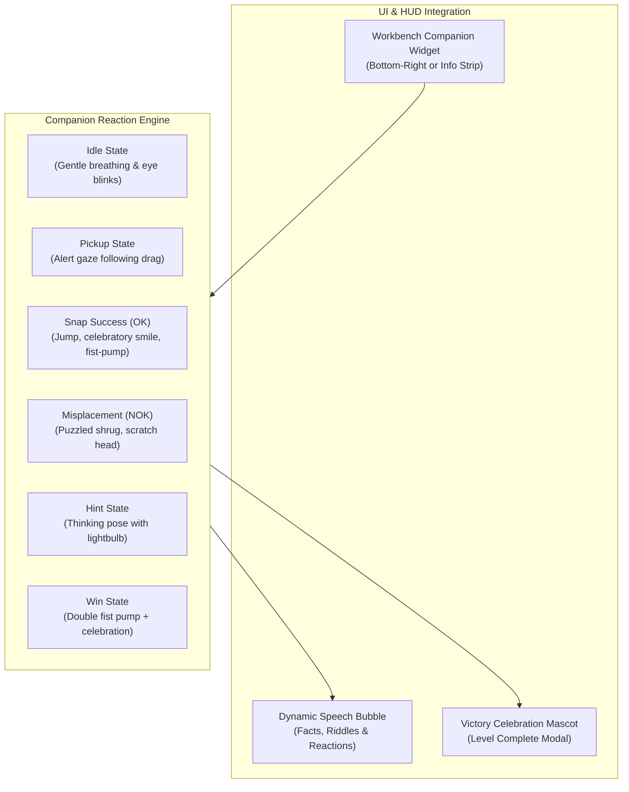

# Integration Plan: Hand-Drawn Companion Character

This plan details how to transform and integrate the hand-drawn sketch in `character.jpg` into **Assembly Lab** as an animated, interactive **Junior Engineer Companion** (e.g., *"Artie"* / *"Sparky"*).

---

## 1. Character Visual Analysis & Style Direction

### Key Visual Features
* **Hair:** Messy, textured dark shag/bangs covering the forehead.
* **Face:** Cheerful round silhouette, curved joyful crescent eyes (`^_^`), and a wide happy grin.
* **Attire:** V-neck pullover shirt with two distinct chest buttons (`:`), comfortable trousers, and a grounded, confident A-stance.
* **Posing:** Outstretched curved arms with cute cartoonish rounded hands.

### Recommended Representation: Faithful Responsive SVG
Since Assembly Lab is completely zero-dependency and 100% SVG/CSS vector-based, translating the pencil sketch into a **vector SVG component** provides major benefits:
1. **Zero-Asset Portability:** Retains the single-file distribution model without external PNG/JPG network dependencies.
2. **Dynamic Rigging & Expressions:** Allows swapping facial expressions (happy, thinking, puzzled, cheering) and animating arms/body using CSS keyframes.
3. **Pencil-Sketch Aesthetic:** We can use subtle hand-drawn path stylization and charcoal/graphite line styling (`stroke-linecap="round"`, organic stroke widths) to preserve the exact warmth and soul of the original pencil drawing.

---

## 2. In-Game Role & Placement

### Proposed Locations
1. **Workbench Corner (Anchor Station):**
   * Placed at the bottom-right corner of the `#assembly-svg` workspace on desktop, or anchored atop the info strip on mobile.
   * Scales crisply with `viewBox`.
2. **Companion Fact Bubble:**
   * Instead of a disconnected horizontal banner, the character directly "speaks" the scientific facts, order clues, and riddles via an animated comic speech bubble.
3. **Victory Celebration in Modal:**
   * Appears inside the Level Complete modal giving a double high-five or jumping with confetti.
4. **Room Scavenger Hunt (Levels 30 & 35):**
   * In Child's Room mode, the character can be perched on the daybed or desk as an in-world room resident helping search for missing components.

---

## 3. Dynamic Emotional State Machine

The character will react in real time to player actions:

| Event | Character State | Animation & Facial Expression | Speech Bubble Feedback |
| :--- | :--- | :--- | :--- |
| **Idle / Waiting** | `idle` | Gentle breathing cycle, occasional double-blink. | *"What should we build next?"* |
| **Part Pickup** | `curious` | Eyes open wide, head tilts slightly toward cursor. | *(Attentive)* |
| **Correct Snap (OK)** | `happy` | Bouncy upward jump, wide crescent smile, arms raise in cheer. | *"Nailed it! Here's a cool fact..."* |
| **Wrong Spot / Order (NOK)** | `puzzled` | Eyebrow quirk, slight head scratch / shrug, mouth turns to a cute squiggly "hmm". | *"Hmm, not quite there! Check the order."* |
| **Hint Requested** | `thinking` | Hand on chin, animated glowing lightbulb pops above hair. | Reads the technical clue or riddle! |
| **Level Complete (Win)** | `celebrate` | Full victory bounce, double fist pump, stars/sparkles. | *"Blueprint unlocked, Junior Engineer!"* |

---

## 4. Implementation Steps

### Phase 1: SVG Vector Component Construction
- [ ] Craft the scalable `<g id="companion-character">` SVG group matching the proportions, hair, buttons, and stance from `character.jpg`.
- [ ] Implement modular sub-layers:
  - `#char-body` (shirt with 2 buttons, pants, shoes)
  - `#char-arms` (resting, cheering, scratching head)
  - `#char-head` (textured hair bangs, cheeks)
  - `#char-face` (eyes and mouth paths with swappable expression classes: `.expr-smile`, `.expr-puzzled`, `.expr-blink`, `.expr-cheer`).

### Phase 2: Companion State Manager & Audio Synchronization
- [ ] Create `updateCompanionState(state, message)` in JavaScript:
  - Hooks into existing `attemptSnap()` & `registerFailedAttempt()`.
  - Integrates seamlessly with the newly added funny cartoon audio effects (e.g., sad trombone plays while character shrugs; bubble pop plays while character jumps).
- [ ] Connect character speech bubble directly to `showFact()`.

### Phase 3: Mobile & Responsive Layout Tuning
- [ ] Ensure the character docks comfortably on narrow screens (`≤ 768px`) without obscuring blueprint connection zones or the subpart tray.
- [ ] Add an optional toggle (e.g. tap character to tickle / trigger an idle animation).

### Phase 4: Victory Modal & Scavenger Integration
- [ ] Embed the celebratory character pose in `#complete-modal`.
- [ ] In Tier 6 (Levels 30 & 35 Child's Room), position the character inside the room layout holding a magnifying glass or flashlight.

---

## 5. Verification & Acceptance Criteria

1. **Visual Fidelity:** The in-game character must be immediately recognizable as the sketch in `character.jpg` (matching hair style, facial warmth, two-button shirt, and pose).
2. **Zero Performance Hit:** Vector SVG + pure CSS transforms running at 60fps with zero layout thrashing or external network requests.
3. **Mobile Clearance:** Must not block the assembly blueprint canvas or the touch drag area.
4. **Seamless Sound Sync:** Emotional transitions fire synchronously with the cartoon OK/NOK sound synthesizers.
